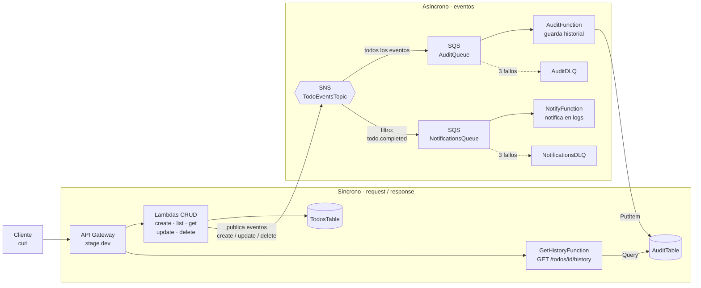
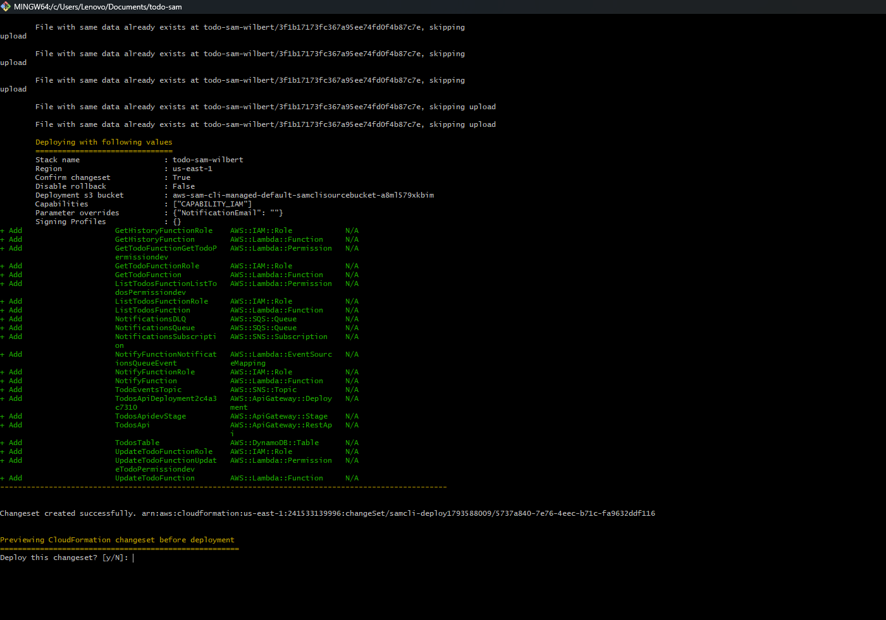
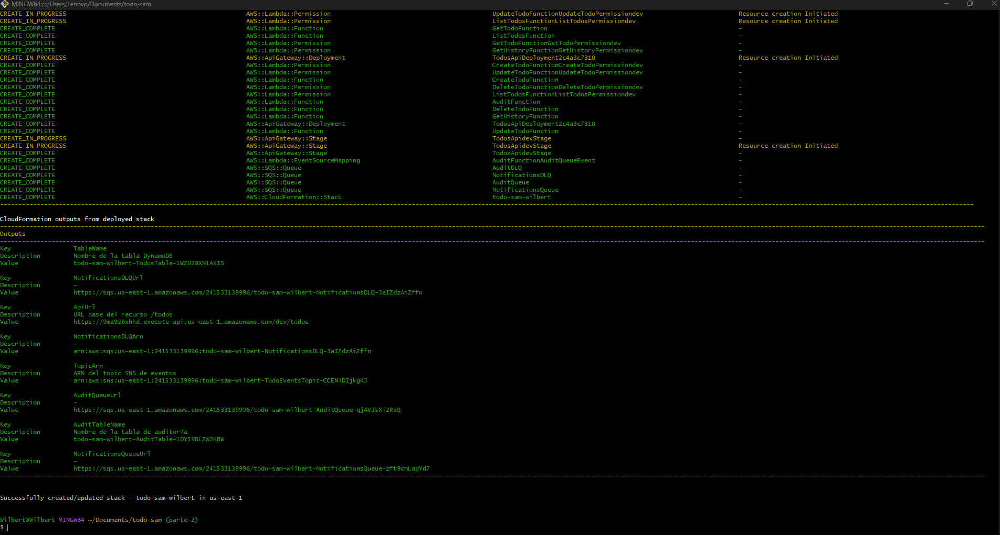
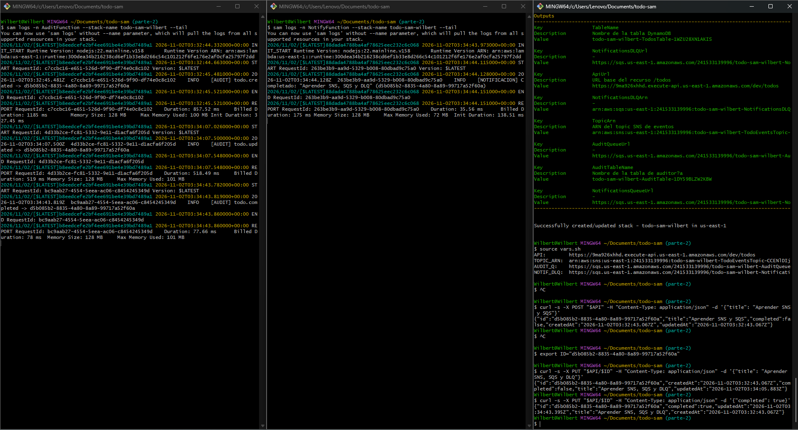
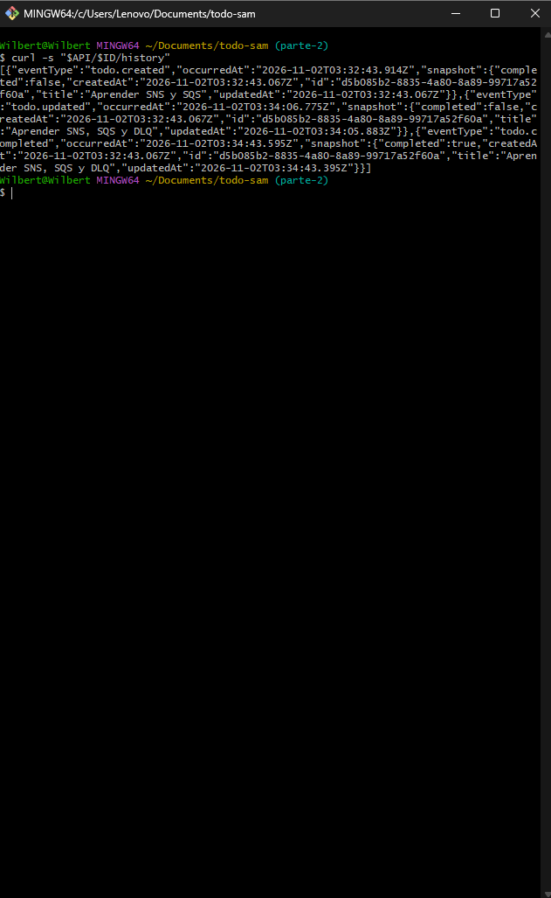
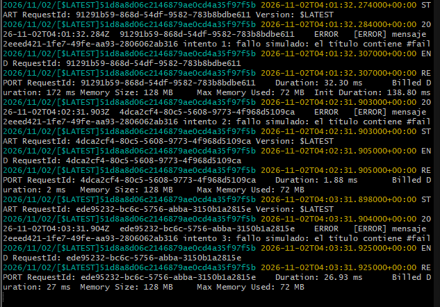
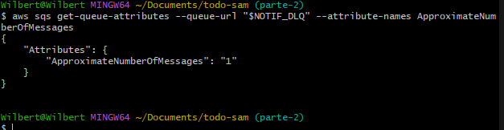
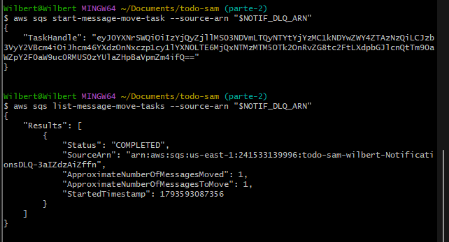

# CRUD de TODOs con AWS SAM — Parte 2: Microservicios con SNS y SQS

Evolución de la API de TODOs de la [Parte 1](../../tree/main) hacia una **arquitectura de microservicios orientada a eventos**, construida en el workshop de **Sistemas Distribuidos**.

La API REST responde exactamente igual que en la Parte 1, pero ahora, después de cada escritura exitosa, publica un **evento de dominio** en Amazon SNS. Ese evento se reparte a colas de Amazon SQS, y desde ellas otros microservicios lo procesan de forma independiente: uno guarda el historial de cambios y otro envía notificaciones.

Toda la infraestructura está definida como código en `template.yaml` con **AWS SAM**.

## Video del recorrido

[Ver video en Google Drive](https://drive.google.com/file/d/1SgLrscwnvFxrYiC0mmbUQOW8xgueVqjq/view?usp=drive_link)

## Arquitectura



**Flujo de un evento:**

1. Una Lambda del CRUD escribe en `TodosTable` y luego publica un evento en el topic SNS.
2. SNS copia el evento a cada cola suscrita (**fan-out**). `NotificationsQueue` tiene una **filter policy** y solo recibe `todo.completed`.
3. Cada cola dispara su propia Lambda consumidora, que procesa los mensajes en lotes.
4. Si un mensaje falla 3 veces, SQS lo mueve a la **Dead-Letter Queue** de esa cola.

## Eventos de dominio

Todos los eventos comparten el mismo formato:

```json
{
  "eventId": "b7e1...-uuid",
  "eventType": "todo.completed",
  "occurredAt": "2026-11-02T03:34:43.595Z",
  "source": "todos-api",
  "data": { "id": "...", "title": "...", "completed": true, "createdAt": "...", "updatedAt": "..." }
}
```

| eventType | Lo publica | Lo recibe |
|---|---|---|
| `todo.created` | `createTodo` | Audit |
| `todo.updated` | `updateTodo` | Audit |
| `todo.completed` | `updateTodo` (con `"completed": true`) | Audit, Notify |
| `todo.deleted` | `deleteTodo` | Audit |

El `eventType` viaja dentro del JSON (para el consumidor) y como **atributo de mensaje** de SNS (para que la filter policy pueda filtrar sin abrir el mensaje).

## Contrato de la API

| Método | Ruta | Respuesta OK | Errores |
|---|---|---|---|
| POST | `/todos` | 201 + TODO creado | 400 |
| GET | `/todos` | 200 + lista | — |
| GET | `/todos/{id}` | 200 + TODO | 404 |
| PUT | `/todos/{id}` | 200 + TODO actualizado | 400, 404 |
| DELETE | `/todos/{id}` | 204 sin contenido | 404 |
| GET | `/todos/{id}/history` **(nuevo)** | 200 + lista de eventos | — |

## Cambios respecto a la Parte 1

| Archivo | Cambio |
|---|---|
| `template.yaml` | Topic SNS, 2 colas + 2 DLQ, política de las colas, suscripciones con filtro, `AuditTable` y 3 Lambdas nuevas |
| `src/package.json` | Agrega `@aws-sdk/client-sns` |
| `src/utils.js` | Agrega `publishEvent`, el cliente SNS y `AUDIT_TABLE_NAME` |
| `src/createTodo.js` | Publica `todo.created` tras guardar |
| `src/updateTodo.js` | Publica `todo.completed` o `todo.updated` tras actualizar |
| `src/deleteTodo.js` | Publica `todo.deleted` con `ReturnValues: ALL_OLD` |
| `src/auditConsumer.js` | **Nuevo.** Consume `AuditQueue` y guarda cada evento en `AuditTable` |
| `src/notifyConsumer.js` | **Nuevo.** Consume `NotificationsQueue` y simula una notificación |
| `src/getHistory.js` | **Nuevo.** Endpoint de historial con `Query` sobre `AuditTable` |
| `vars.sh` | Script para cargar los Outputs del stack en variables de entorno |
| `events/manual-completed.json` | Evento para publicar a mano en SNS |

> En `notifyConsumer.js`, el fallo simulado con `#fail` sirve para probar reintentos y DLQ. Se comenta para simular la corrección del bug antes de hacer el redrive.

## Cómo desplegarlo

```bash
sam validate --lint
sam build
sam deploy --guided   # Parameter NotificationEmail: Enter (vacío)
source vars.sh        # carga API, TOPIC_ARN, colas y DLQ en variables
```

El usuario IAM necesita, además de los permisos de la Parte 1, acceso a **SQS** y **SNS**.

Para borrar todos los recursos:

```bash
sam delete --stack-name todo-sam-wilbert
```

## Evidencias

| Prueba | Captura |
|---|---|
| Change set del deploy |  |
| Outputs nuevos |  |
| Logs de AuditFunction y NotifyFunction (demuestra el filtro) |  |
| Historial con 4 eventos |  |
| Mensaje `#fail`: 3 intentos en los logs |  |
| DLQ con 1 mensaje |  |
| Redrive exitoso |  |
| `sam delete` completado | Ver en el video |

## Qué aprendí

- **Bajo acoplamiento**: la API solo publica eventos y no sabe quién los escucha. Se pueden agregar consumidores nuevos sin tocar el CRUD.
- **Fan-out con filtros**: un mismo evento llega a varios consumidores, y cada uno puede recibir solo lo que le interesa. En las pruebas, al crear, editar y completar una tarea, el auditor registró 3 eventos y el notificador solo 1.
- **La cola como buffer**: al desactivar el trigger del auditor, la API siguió respondiendo normal y los mensajes esperaron en la cola. Al reactivarlo, se procesaron todos. Lambda incluso levantó dos instancias en paralelo para vaciar la cola.
- **Reintentos y DLQ**: un mensaje que siempre falla se reintentó 3 veces (cada 60 s, por el `VisibilityTimeout`) y terminó en la DLQ. Después de corregir el bug, el redrive lo devolvió a su cola y se procesó bien: el mensaje nunca se perdió.
- **Aislamiento de fallos**: el mismo evento `#fail` falló en el notificador pero se procesó bien en el auditor.
- **Consistencia eventual**: el historial puede tardar unos milisegundos en reflejar un cambio, porque el evento recorre SNS → SQS → Lambda → DynamoDB.
- **Permisos de servicio**: el primer deploy falló porque mi usuario IAM no tenía permisos sobre SQS y SNS. CloudFormation hizo rollback automático y fue necesario borrar el stack antes de volver a desplegar.
- **Seguridad de los eventos**: al publicar a mano en SNS, el historial registró un TODO que nunca existió. Cualquiera con `sns:Publish` puede inyectar eventos, por lo que conviene restringir quién publica con una política de recurso en el topic.

## Preguntas de repaso

**1. ¿Qué diferencia hay entre SNS y SQS? ¿Por qué en este workshop los usamos juntos?**

SNS es un servicio de publicación/suscripción: entrega cada mensaje a todos sus suscriptores en el momento, pero no lo almacena. SQS es una cola: guarda los mensajes hasta que un consumidor los procese y los borre. Se usan juntos (patrón fan-out) porque SNS permite que un evento llegue a varios consumidores, y SQS le da a cada consumidor su propio buffer, ritmo de procesamiento, reintentos y DLQ, independientes de los demás.

**2. Si mañana se agrega un microservicio de estadísticas, ¿qué archivos del CRUD hay que modificar? ¿Por qué?**

Ninguno. Basta con agregar en `template.yaml` una nueva cola suscrita al topic y su Lambda consumidora. Las Lambdas del CRUD solo publican en el topic y no conocen a sus consumidores, así que no se enteran de que existe uno nuevo.

**3. Un lote trae 10 mensajes y falla 1. ¿Qué pasa si el handler devuelve `batchItemFailures`? ¿Y si lanza una excepción?**

Con `batchItemFailures` (y `ReportBatchItemFailures` en el template), SQS borra los 9 mensajes exitosos y solo reintenta el que falló. Si el handler lanza una excepción, Lambda considera fallido el lote completo y los 10 mensajes vuelven a la cola, incluidos los que ya se habían procesado bien, lo que genera reprocesamiento innecesario.

**4. ¿Por qué la `sk` de AuditTable incluye el `eventId`? ¿Qué problema evita?**

Hace que el consumidor sea **idempotente**. SQS garantiza entrega *al menos una vez*, así que un mensaje puede llegar duplicado. Como la `sk` (`occurredAt#eventId`) se construye con datos del propio evento, un duplicado produce la misma clave y el `PutItem` sobrescribe el mismo ítem en lugar de duplicar el registro en el historial. Además, el `eventId` evita que dos eventos distintos ocurridos en el mismo instante se sobrescriban entre sí.

**5. ¿Por qué el `VisibilityTimeout` de la cola debe ser mayor que el `Timeout` de la Lambda?**

Mientras una Lambda procesa un mensaje, este queda invisible durante el `VisibilityTimeout`. Si ese tiempo fuera menor que el `Timeout` de la función, el mensaje volvería a ser visible mientras la Lambda todavía lo procesa, y otra invocación lo tomaría, procesándolo dos veces. AWS recomienda al menos 6 veces el `Timeout` de la función: por eso se usan 60 s frente a 10 s.

**6. El mensaje `#fail` lo procesó bien AuditFunction pero no NotifyFunction. ¿Qué propiedad de la arquitectura demuestra eso?**

El **aislamiento de fallos** (desacoplamiento entre consumidores). Cada consumidor tiene su propia cola, sus propios reintentos y su propia DLQ, así que el fallo de uno no afecta a los demás.

**7. ¿Qué riesgo tiene publicar en SNS después de escribir en DynamoDB, y cómo lo mitigarías?**

Es una **doble escritura** en dos sistemas sin una transacción común. Si el `PutItem` en DynamoDB tiene éxito pero la publicación en SNS falla, el TODO existe pero el evento nunca sale: el historial queda incompleto y el cliente recibe un 502 aunque su TODO sí se creó. Se mitiga con el **patrón outbox**: activar DynamoDB Streams en `TodosTable` y publicar en SNS desde una Lambda que reacciona a cada cambio de la tabla (o con EventBridge Pipes). Así, si la escritura ocurrió, el evento termina publicándose.

## Autor

Wilbert — Sistemas Distribuidos
