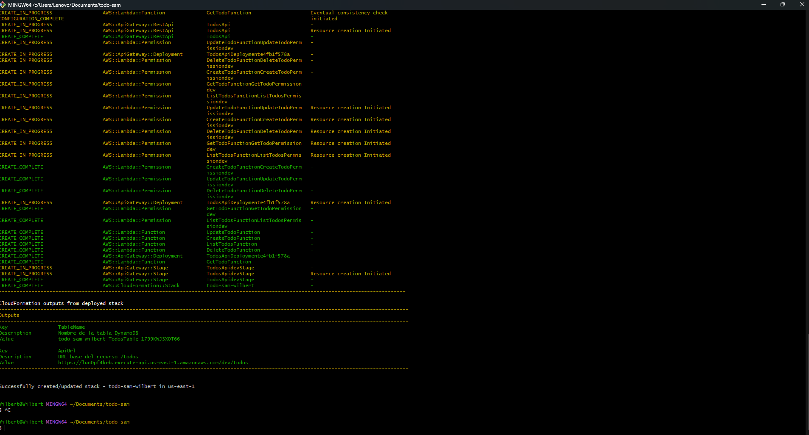
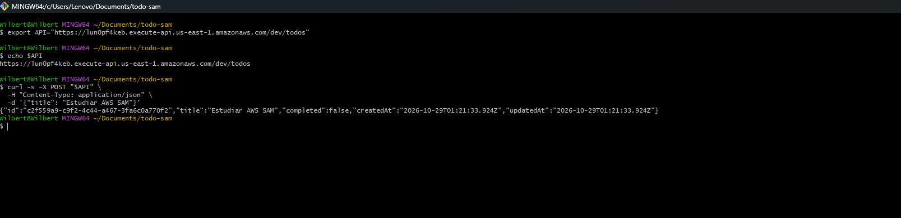

# CRUD de TODOs con AWS SAM (Node.js)

API REST serverless para gestionar una lista de tareas (TODOs), construida en el workshop de **Sistemas Distribuidos**. Toda la infraestructura está definida como código en `template.yaml` usando **AWS SAM**; no se creó ningún recurso a mano en la consola de AWS.

## Arquitectura

```
Cliente (curl)
     │
     ▼
API Gateway (REST, stage "dev")
     │
     ├── POST   /todos        → CreateTodoFunction
     ├── GET    /todos        → ListTodosFunction
     ├── GET    /todos/{id}   → GetTodoFunction
     ├── PUT    /todos/{id}   → UpdateTodoFunction
     └── DELETE /todos/{id}   → DeleteTodoFunction
                                     │
                                     ▼
                            DynamoDB (TodosTable)
```

- **API Gateway**: expone los endpoints REST.
- **AWS Lambda** (Node.js 22): una función por cada operación CRUD.
- **Amazon DynamoDB**: tabla `TodosTable` con clave de partición `id` y facturación bajo demanda (`PAY_PER_REQUEST`).

## Estructura del proyecto

```
todo-sam/
├── template.yaml      # Infraestructura (tabla, API, Lambdas, permisos)
├── samconfig.toml     # Configuración guardada del deploy
├── env.json           # Variables para pruebas locales (opcional)
├── events/
│   └── create.json    # Evento de prueba local (opcional)
├── src/
│   ├── package.json   # ES Modules + AWS SDK v3
│   ├── utils.js       # Cliente DynamoDB, respuesta HTTP y parseo del body
│   ├── createTodo.js
│   ├── listTodos.js
│   ├── getTodo.js
│   ├── updateTodo.js
│   └── deleteTodo.js
└── capturas/          # Evidencias
```

## Contrato de la API

| Método | Ruta | Body | Respuesta OK | Errores |
|---|---|---|---|---|
| POST | `/todos` | `{"title": "..."}` | 201 + TODO creado | 400 |
| GET | `/todos` | — | 200 + lista | — |
| GET | `/todos/{id}` | — | 200 + TODO | 404 |
| PUT | `/todos/{id}` | `{"title"?, "completed"?}` | 200 + TODO actualizado | 400, 404 |
| DELETE | `/todos/{id}` | — | 204 sin contenido | 404 |

## Cómo desplegarlo

Requisitos: cuenta de AWS, AWS CLI v2 con credenciales configuradas, AWS SAM CLI y Node.js 22.

```bash
sam validate --lint
sam build
sam deploy --guided     # solo la primera vez; luego basta con: sam build && sam deploy
```

Para borrar todos los recursos:

```bash
sam delete --stack-name todo-sam-wilbert
```

## Evidencias

### Outputs del deploy



### post-crear




### get-listar


### Video de pruebas

Pruebas del CRUD completo, casos de error (400 y 404), logs en CloudWatch y `sam delete`:

[Ver video](capturas/get-id,%20put,%20delete,%20error%20(400,404),%20logs,%20sam-delete.mp4)

## Qué aprendí

- **Infraestructura como código**: con un solo archivo (`template.yaml`) se crea y se borra toda la aplicación. Después de `sam delete`, volver a tenerla es solo `sam build && sam deploy`.
- **SAM crea mucho por mí**: escribí 7 recursos (1 tabla, 1 API y 5 funciones), pero en el deploy se crearon más de 20. SAM generó los 5 roles IAM, los 5 permisos para que API Gateway invoque cada Lambda, y el *deployment* y el *stage* `dev` de la API.
- **Variables de entorno en vez de valores fijos**: el nombre de la tabla lo genera CloudFormation (`todo-sam-wilbert-TodosTable-...`) y llega a las Lambdas por `TABLE_NAME` con `!Ref TodosTable`. Así el código no depende de un nombre escrito a mano.
- **Menor privilegio**: las funciones que solo leen (`ListTodos` y `GetTodo`) tienen `DynamoDBReadPolicy`; las que escriben tienen `DynamoDBCrudPolicy`. Ambas limitadas a esta tabla. Si una función de lectura tuviera un fallo, no podría modificar ni borrar datos.
- **`ConditionExpression: attribute_exists(id)`**: en DynamoDB, un `Update` sobre un id que no existe crea un ítem nuevo. Esta condición lo impide y permite responder 404. En el `Delete` pasa algo parecido: sin la condición, borrar algo inexistente respondería éxito.
- **Validar antes de consultar la base de datos**: un `PUT` con `{"completed": "si"}` sobre un TODO ya borrado responde **400 y no 404**, porque la validación del body ocurre antes de consultar DynamoDB.
- **Cold start**: en los logs de CloudWatch, la primera invocación muestra `Init Duration` y tarda más; las siguientes son más rápidas porque Lambda reutiliza el contenedor. Por eso el cliente de DynamoDB se crea fuera del `handler`.
- **Formato de respuesta de Lambda**: API Gateway exige `statusCode`, `headers` y `body` como string; si no, el cliente recibe un 502.

## Autor

Wilbert Daniel Avila — Sistemas Distribuidos
